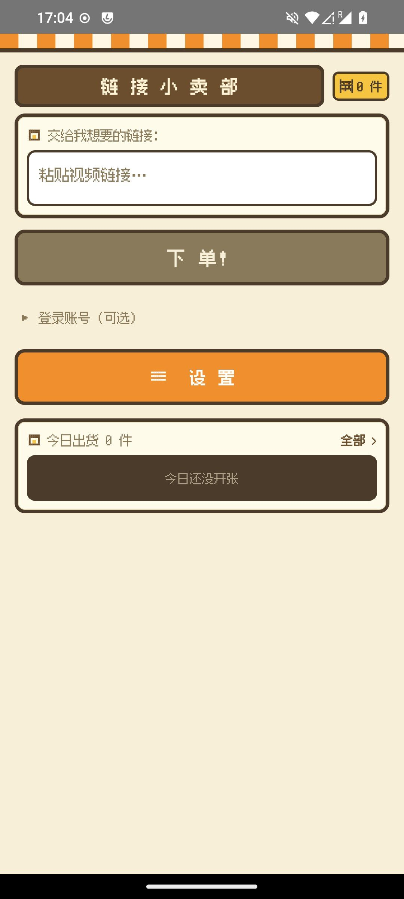
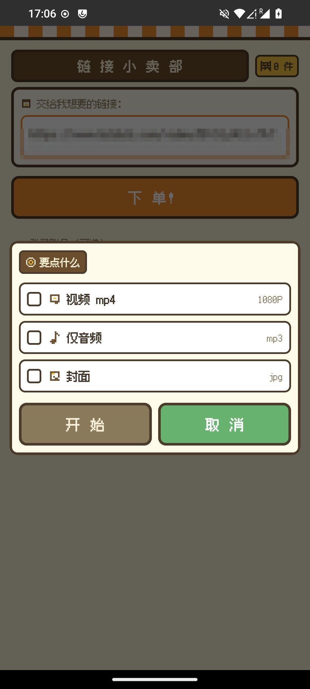
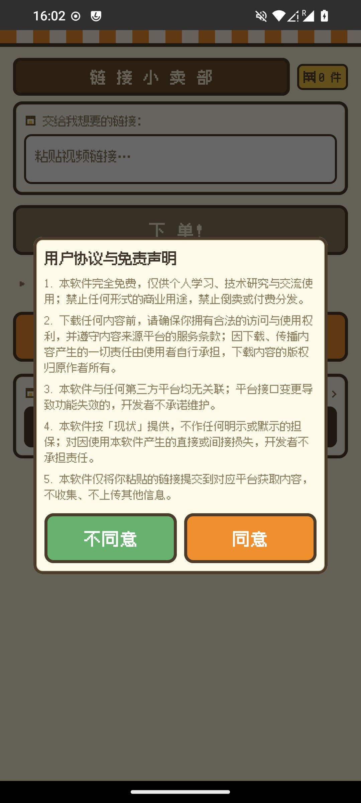
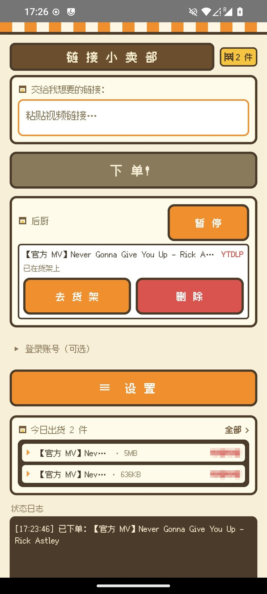
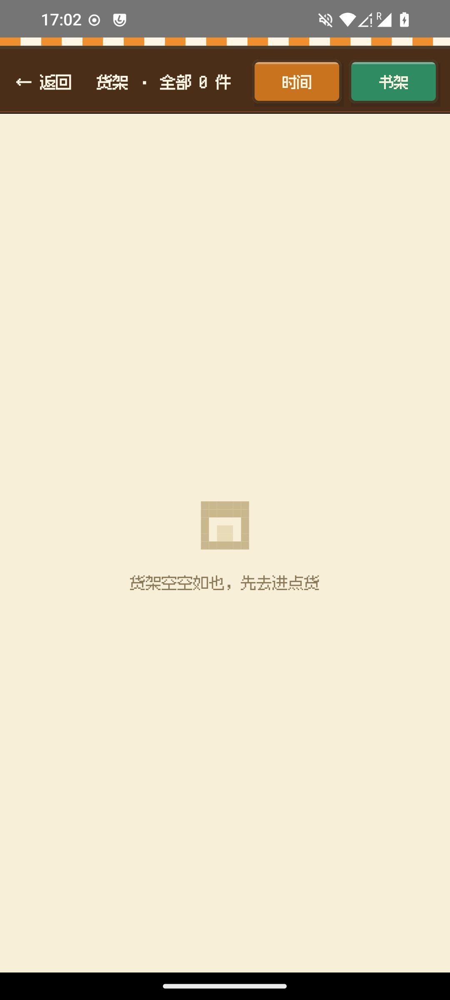
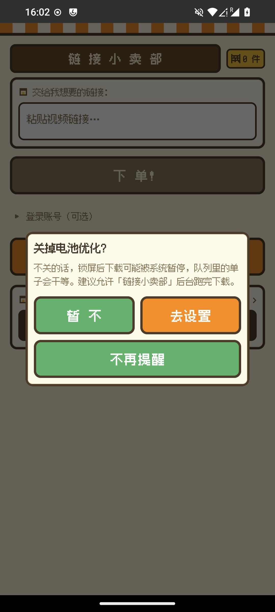
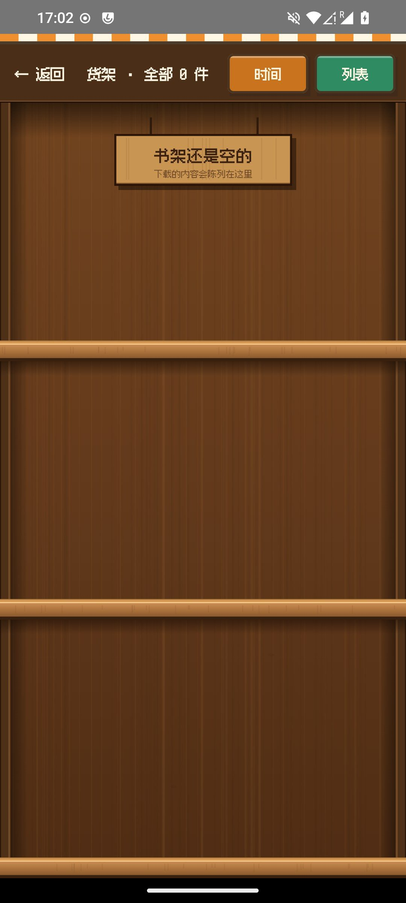

[中文](README.md) | English

# Linkdown

A local video/audio downloader for Android. Paste a share link, pick what you want (video / audio only / cover), and the download queue delivers it straight to your device's media store. Retro pixel UI, local-first, all data stays on the device.

[](LICENSE)

-green)

[Install](#install) · [Features](#features) · [Screenshots](#screenshots) · [Building](#building-from-source) · [Contributing](#contributing) · [License](#license)

## Install

Grab the latest APK from the [Releases](https://github.com/liuyouwu1999/linkdown/releases) page (arm64-v8a; works on recent phones and tablets). Requires Android 10 (API 29) or newer.

Every release ships with a SHA-256 checksum for verification.

## Features

Ordering:

- Share-to-download: tap "Share" in any app and pick Linkdown; the link is recognized automatically
- Choose what you want before downloading: video (mp4) / audio only (mp3·m4a) / cover (jpg), any combination
- Also accepts pasted links on the main screen; common short-link forms are expanded automatically

Queue:

- Foreground-service download queue with adjustable concurrency (2/3/4); losing network switches tasks to "waiting" and resumes automatically
- Tasks survive process death: restarting the app restores the queue
- Already-downloaded content is detected and skipped, never duplicated
- One-tap retry on failure; completed parts are never re-downloaded

Media library:

- Products are archived per platform under the system Downloads folder (`Download/链接下载/<platform>/`), visible to gallery and file managers
- In-app "shelf" page to play, delete and browse by platform
- Optional audio transcoding to mp3 / m4a with tags and cover art

Batch:

- Collection-style links (Bilibili series, UP-loader lists, anime seasons): enumerate first, confirm "title · N items", then download as one order
- Parent/child aggregation: one card per collection with live progress

Engine:

- Dual-engine architecture: [yt-dlp-android](https://github.com/liuyouwu1999/linkdown-ytdlp-android) (sites supported by yt-dlp, see the [upstream list](https://github.com/yt-dlp/yt-dlp/blob/master/supportedsites.md)) plus pure-Kotlin native engines (Douyin, Qishui Music)
- Precise per-task cancellation

The app contains no analytics, ads or tracking SDKs. Only the links you paste are submitted to the corresponding platforms; everything else stays on the device. "Check for updates" connects to GitHub or its mirror only when triggered manually or by the optional on-launch check (once per 24h, can be disabled in Settings), and only fetches version info and the update package. In-app updates are installed through the system installer; the first update requires granting the "install unknown apps" permission when prompted.

## Screenshots

| Main | Order dialog | User agreement |
|:---:|:---:|:---:|
|  |  |  |

| Download queue | Shelf | Battery guide |
|:---:|:---:|:---:|
|  |  |  |

The shelf page has two view modes: list and a wooden "bookshelf" board view (items displayed by cover on planks; tap to play, long-press to remove):

| Board view |
|:---:|
|  |

## Building from source

Requires JDK 21 and Android SDK (compileSdk 37). Minimum Android 10.

```bash
# 1. Build the engine library and publish it to local Maven
git clone https://github.com/liuyouwu1999/linkdown-ytdlp-android.git
cd linkdown-ytdlp-android && ./gradlew publishToMavenLocal   # 仓库根执行（gradlew 在 fork 根，不在 library/ 下）
cd ../..

# 2. Build the app
git clone https://github.com/liuyouwu1999/linkdown.git
cd linkdown
# Opening in Android Studio generates local.properties automatically, or:
./gradlew :app:assembleDebug
```

(Optional) release signing: set `release.keystore.path` / `release.keystore.password` /
`release.keystore.alias` in `local.properties` (gitignored). Without them the build produces an unsigned APK.

## Contributing

Issues for bugs and feature requests are welcome. For PRs, please open an issue first to discuss the approach; commit messages should follow [Conventional Commits](https://www.conventionalcommits.org/en/v1.0.0/).

## Always free, no resales

Linkdown is and always will be free. The only official distribution channels are this repository and its [Releases](https://github.com/liuyouwu1999/linkdown/releases) page.

Any app store, website or individual selling, bundling or otherwise charging for this software is a scam impersonating the developer. Please do not pay for it; if you encounter such listings, report them to the platform or open an [issue](https://github.com/liuyouwu1999/linkdown/issues).

## Disclaimer

This software is provided "as is", without warranty of any kind, express or implied. To the maximum extent permitted by law, the developer shall not be liable for any direct or indirect damages arising from the use of, or inability to use, this software.

The software only provides link resolution and file download capabilities; it does not host, store or recommend any content. You are solely responsible for the source and legality of what you download: make sure you have the right to access the content, and comply with the terms of service of the platforms involved and the laws of your jurisdiction. The same agreement is shown on first launch of the app.

## Third-party components

| Component | Purpose | License |
|---|---|---|
| [yt-dlp-android](https://github.com/liuyouwu1999/linkdown-ytdlp-android) (this project's fork; upstream [yausername/youtubedl-android](https://github.com/yausername/youtubedl-android)) | yt-dlp engine wrapper | MIT |
| [yt-dlp](https://github.com/yt-dlp/yt-dlp) | multi-platform resolution (embedded in the engine library) | The Unlicense |
| [FFmpeg](https://ffmpeg.org) (static self-built 8.1.2 + libmp3lame, invoked as a separate process) | audio extraction / transcoding | LGPL-2.1+ |
| [OkHttp](https://github.com/square/okhttp) | HTTP for native engines | Apache-2.0 |
| [kotlinx.serialization](https://github.com/Kotlin/kotlinx.serialization) | platform API JSON | Apache-2.0 |
| Jetpack Compose, DataStore, Lifecycle and other AndroidX libraries | UI and storage | Apache-2.0 |
| [fusion-pixel-font](https://github.com/TakWolf/fusion-pixel-font) | pixel UI font | SIL OFL 1.1 |

All components are copyright their respective authors; thanks to the open-source community.

## License

This project is licensed under the [GNU GPL v3](LICENSE). Derivative works must be licensed under the same terms and retain the copyright notices.
